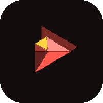
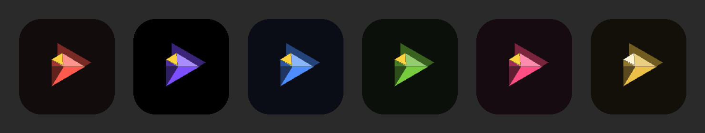

  

<h1 align="center">KamiShibai</h1>

<b>Déroule. Regarde.</b> par ORIKAMI

  <a href="https://github.com/orikami-dev/kamishibai/releases/latest">⬇️ <b>Télécharger la dernière version</b></a>
  ·
  <a href="https://github.com/orikami-dev/kamishibai/releases">📦 Toutes les versions</a>
  ·
  <a href="CHANGELOG.md">📝 Journal des versions</a>

---

## 🎴 Le projet

KamiShibai est YouTube sans publicité, pensé pour le téléphone et les pliants. Il garde tout le moteur de [SmartTube](https://github.com/yuliskov/SmartTube) (sans pub, SponsorBlock, choix de la qualité, lecture en arrière-plan), conçu à l'origine pour la télé, et lui donne une vraie interface tactile.

| | |
|---|---|
| 📺 **Un seul écran** | La vidéo monte dans un panneau par-dessus l'Accueil et redescend d'un geste. |
| 🪟 **Mini-lecteur** | La vidéo continue dans une petite carte pendant que tu navigues. |
| 📱 **Shorts** | À la verticale, avec les actions sur le côté, comme sur YouTube. |
| 🔍 **Recherche intégrée** | Le champ s'ouvre dans la barre du haut, les résultats remplacent le flux. |
| 🔑 **Connexion Google** | Par code d'activation, comme sur une télé : ton mot de passe ne passe jamais par l'app. |
| 📥 **Téléchargement** | Vidéos et audio, rangés dans tes dossiers Films et Musique. |
| 🔄 **Mises à jour intégrées** | Les nouvelles versions sont proposées directement dans l'app. |

## 🎨 Six palettes

Chaque palette colore l'interface, le logo et l'icône de l'app.

| Palette | En une phrase |
|---|---|
| 📜 **Washi** | Le papier japonais et le vermillon des torii. |
| 🖋️ **Sumi** | L'encre de Chine, noir profond et violet. |
| 🌊 **Ai** | Le bleu indigo des teintures japonaises. |
| 🍵 **Matcha** | Le vert tendre du thé. |
| 🌸 **Sakura** | Le rose des cerisiers en fleurs. |
| 🪙 **Kin** | L'or des feuilles de laque. |

  

## ✨ Points forts

- 📐 Même disposition sur tous les écrans d'un pliant, taille adaptée à chaque écran.
- 📖 Pliant à moitié ouvert en plein écran : la vidéo au-dessus de la charnière, les commandes en dessous.
- 🧭 Barre du bas : Accueil, Shorts, Abonnements, Historique, Paramètres ; Explorer pour la bibliothèque.
- 🎛️ Menus du lecteur qui s'ouvrent depuis leur bouton, réglages en tuiles.
- 🚀 Démarrage direct, sans écran de logo.
- 🤝 S'installe à côté de SmartTube, sans le remplacer.

## ⭐ Mises à jour majeures

| Version | Ce qu'elle a apporté |
|---|---|
| [1.0](https://github.com/orikami-dev/kamishibai/releases/tag/v1.0) | Première version publique : un seul écran avec mini-lecteur, Shorts, six palettes, pliants à moitié ouverts, mises à jour intégrées. |

## 🛠️ Le dépôt

| Dossier | Contenu |
|---|---|
| `smarttubetv/src/stmobile/` | Toute l'interface de téléphone de KamiShibai |
| `kamishibai/` | Notes, points de contact avec SmartTube, synchronisation, générateurs de logos |
| reste du dépôt | Le code de SmartTube, gardé tel quel pour suivre ses mises à jour |
| `docs/` | Notes de chaque version (`docs/releases`), images |

Construire (JDK 17, SDK Android 34) : `./gradlew :smarttubetv:assembleStmobileDebug`. Les fichiers de SmartTube touchés sont listés dans [kamishibai/UPSTREAM-TOUCHPOINTS.md](kamishibai/UPSTREAM-TOUCHPOINTS.md).

## ⚖️ Licences

KamiShibai est une version modifiée de [SmartTube](https://github.com/yuliskov/SmartTube) de yuliskov et ses contributeurs, distribuée comme lui sous licence MIT ; la mention de copyright d'origine reste dans [LICENSE](LICENSE) (voir aussi [NOTICE.md](NOTICE.md)). Pour soutenir SmartTube : [ko-fi.com/smarttube](https://ko-fi.com/smarttube). KamiShibai n'est affilié ni à YouTube ni à Google.
